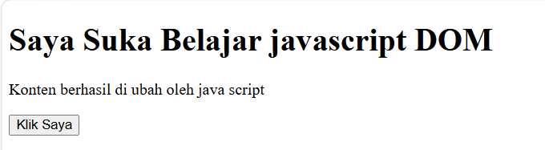
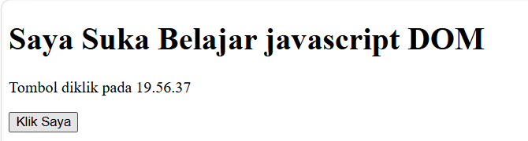
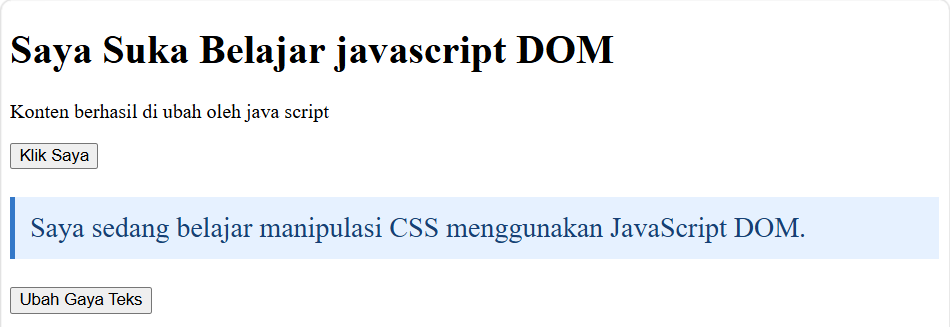
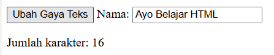
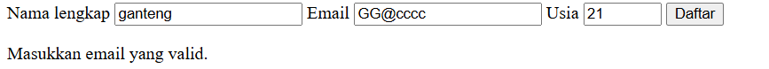
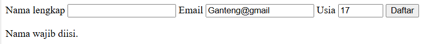

# Lab 6 Web
## JavaScript & Event Handling

### 1. Mengubah Teks dengan DOM

Pada latihan ini, kita mempelajari cara mengubah teks pada elemen HTML menggunakan JavaScript melalui konsep **DOM (Document Object Model)**.

Pertama, buat elemen HTML menggunakan tag `<h1>` dengan atribut `id="judul"`:

```html
<h1 id="judul">Latihan DOM</h1>
```

Selanjutnya, gunakan JavaScript untuk mengubah isi teks dari elemen tersebut:

```javascript
judul.textContent = "Saya Suka Belajar JavaScript DOM";
```

**Kesimpulan:**

Berdasarkan latihan di atas, dapat disimpulkan bahwa JavaScript dapat digunakan untuk mengubah isi teks pada elemen HTML melalui DOM dengan memanfaatkan properti `textContent`.

###  Result

Berikut adalah hasil dari latihan mengubah teks menggunakan JavaScript DOM:



### 2. Even click

Program menggunakan addEventListener() untuk mendeteksi ketika tombol diklik.

```javascript
const tombol = document.getElementById("tombolAksi");

tombol.addEventListener("click", function() {
    pesan.textContent = "Tombol diklik pada " + new Date().toLocaleTimeString();
}); 
```

### Result



### 3. Mengubah kelas dan gaya CSS

Mengatur tampilan dan desain elemen HTML.
Class yang digunakan:
```css
.highlight
```
Mengubah warna teks.
Memberikan warna background.
Menambahkan garis di sebelah kiri.
Memberikan jarak dalam elemen menggunakan padding.

```css
.teks-besar
```
Memperbesar ukuran teks menjadi 1.4rem.

JavaScript (script.js)

Fungsi: Membuat halaman web menjadi interaktif.

A. Mengakses elemen DOM
Menggunakan document.getElementById() untuk mengambil elemen HTML berdasarkan ID.
Menggunakan textContent untuk mengganti isi teks pada judul dan paragraf.

C. Event Click

Menggunakan addEventListener("click") untuk mendeteksi ketika tombol diklik.

Ketika tombol diklik, program menampilkan waktu saat tombol ditekan menggunakan Date() dan toLocaleTimeString().

D. Manipulasi Class CSS

Menggunakan classList.toggle() untuk menambahkan atau menghapus class CSS secara bergantian ketika tombol diklik.

### Result



### 4. Even Input dan Penghitung Karakter

Menambahkan Even input yang di ketik akan otomatis menghitung jumlah karekter

``html
<input type="text" id="namaInput" maxlength="40">

<p>Jumlah karakter: 
    <span id="jumlahKarakter">0</span>
</p>
```
Penjelasan:
- input type="text": Membuat kolom untuk memasukkan teks.
- id="namaInput": Identitas kolom input agar bisa diakses JavaScript.
- maxlength="40": Membatasi input maksimal 40 karakter.
- <p>: Menampilkan tulisan jumlah karakter.
- <span id="jumlahKarakter">0</span>: Tempat menampilkan hasil hitungan karakter.

```javascript
const namaInput = document.getElementById("namaInput");
const jumlahKarakter = document.getElementById("jumlahKarakter");

namaInput.addEventListener("input", function () {
    jumlahKarakter.textContent = namaInput.value.length;
});
```
Penjelasan:
namaInput.value: Mengambil teks yang diketik pengguna.
.length: Menghitung jumlah karakter dalam teks.
textContent: Menampilkan hasil hitungan ke HTML.

### Result



### 5. Validasi form pendaftaran

JavaScript memeriksa data yang dimasukkan pengguna sebelum form diproses atau dikirim.

Ada 3 data yang harus diperiksa:

1. Nama lengkap wajib diisi.
2. Email harus memiliki format yang valid.
3. Usia harus berupa bilangan bulat antara 17 sampai 100 tahun.

Kode dan Fungsi

getElementById() -> Mengambil elemen HTML
addEventListener("submit") -> Mendeteksi pengiriman form
preventDefault() -> Mencegah form terkirim otomatis
.value ->	Mengambil nilai input
.trim() ->	Menghapus spasi awal dan akhir
Number() -> Mengubah teks menjadi angka
Regex.test() -> Memeriksa format email
Number.isInteger() -> Memeriksa bilangan bulat
textContent	Menampilkan pesan
form.reset() -> Mengosongkan form

### Result



